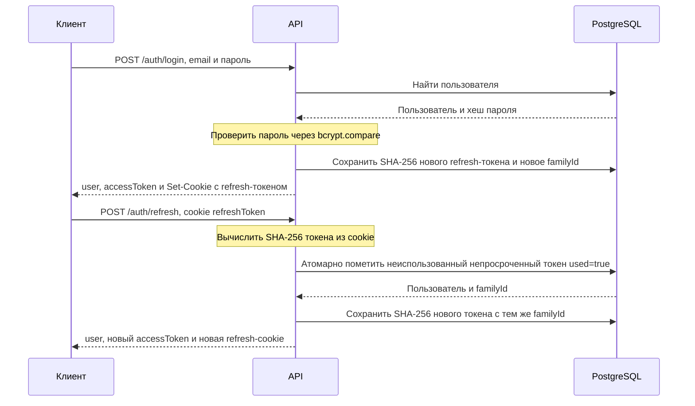

# Fakegram API

Бэкенд мини-Instagram на NestJS. Реализует аутентификацию через JWT + refresh-токены, управление пользователями, альбомами, фотографиями и комментариями.

## Стек

| Слой           | Технология                               |
| -------------- | ---------------------------------------- |
| Фреймворк      | NestJS (Node.js + TypeScript)            |
| База данных    | PostgreSQL 18                            |
| ORM            | Prisma                                   |
| Аутентификация | JWT (access) + httpOnly cookie (refresh) |
| Валидация      | class-validator / class-transformer      |
| Запуск БД      | Docker Compose                           |

---

## Запуск проекта локально

### Предварительные требования

- [Node.js](https://nodejs.org/) 24.x LTS. Точная версия — в `.nvmrc`; установка через nvm описана ниже
- [Docker Desktop](https://www.docker.com/products/docker-desktop/) (для PostgreSQL)
- npm

> Диапазон допустимых версий Node и npm задан в `engines` (`package.json`), а `engine-strict=true`
> в `.npmrc` заставляет `npm install` падать с внятной ошибкой на чужом мажоре вместо тихого warning.

### 1. Клонировать репозиторий

```bash
git clone https://github.com/Grinder21/fakegram-api.git
cd fakegram-api
```

Для macOS/Linux с установленным [nvm](https://github.com/nvm-sh/nvm#nvmrc):

```bash
nvm install
nvm use
```

`nvm install` читает `.nvmrc` и устанавливает нужную версию, если её ещё нет.
Для последующих запусков достаточно `nvm use`.

На Windows с [nvm-windows](https://docs.nvm-windows.com/) передай версию явно
(PowerShell):

```powershell
$nodeVersion = (Get-Content .nvmrc).Trim()
nvm install $nodeVersion
nvm use $nodeVersion
```

Если PowerShell блокирует `npm.ps1` или `npx.ps1`, используй `npm.cmd` и
`npx.cmd` вместо `npm` и `npx` в командах ниже.

### 2. Создать файл `.env`

```bash
cp .env.example .env
```

Значения из `.env.example` подходят для локальной разработки. Заполнить нужно только `JWT_ACCESS_SECRET` —
сгенерировать случайную строку минимум из 32 символов:

```bash
openssl rand -base64 32
```

На Windows без OpenSSL то же самое делает Node:

```bash
node -e "console.log(require('crypto').randomBytes(32).toString('base64'))"
```

Переменные окружения проверяются при старте (`src/common/env.validation.ts`): если обязательная переменная
не задана или значение некорректно, приложение не запустится и назовёт переменную в сообщении об ошибке.
Описание всех переменных — в [CONTRIBUTING.md](CONTRIBUTING.md#переменные-окружения).

### 3. Поднять базу данных

```bash
docker compose up -d
```

Проверить что контейнер запустился:

```bash
docker compose ps
```

### 4. Установить зависимости и применить миграции

```bash
npm install
npx prisma migrate deploy
```

`npm install` выполняет `postinstall` → `prisma generate`, поэтому `.env` с
заполненным `DATABASE_URL` нужен уже на этом шаге. Если генерация падает,
см. [диагностику DATABASE_URL](CONTRIBUTING.md#ошибка-database_url-при-установке-зависимостей).

### 5. Запустить сервер

```bash
# dev-режим с hot reload
npm run start:dev

# или обычный запуск
npm run start
```

API доступен на `http://localhost:3000`.

---

## Тестирование

Unit-тесты выполняются на Vitest без подключения к БД:

```bash
npm test
npm run test:watch
npm run test:cov
npm run typecheck
```

HTTP E2E-тесты используют настоящие сервисы и отдельную PostgreSQL-базу
`fakegram_e2e`. После создания базы и применения миграций:

```bash
npm run test:e2e
```

Готовые команды подготовки базы и описание сценариев — в
[docs/testing.md](docs/testing.md#подготовка-базы).

## Эндпоинты

### Auth

| Метод | Путь             | Доступ                | Описание                          |
| ----- | ---------------- | --------------------- | --------------------------------- |
| POST  | `/auth/register` | Публичный             | Регистрация                       |
| POST  | `/auth/login`    | Публичный             | Вход                              |
| POST  | `/auth/refresh`  | Cookie `refreshToken` | Обновить access- и refresh-токены |
| POST  | `/auth/logout`   | Bearer JWT            | Выход со всех устройств           |
| GET   | `/auth/me`       | Bearer JWT            | Текущий пользователь              |

### Пользователи, альбомы, фото и комментарии

Все маршруты в таблице требуют `Authorization: Bearer <accessToken>`.
Идентификаторы — UUID.

| Метод  | Путь                   | Доступ                                        | Описание                                                          |
| ------ | ---------------------- | --------------------------------------------- | ----------------------------------------------------------------- |
| GET    | `/users/:id`           | Любой авторизованный пользователь             | Профиль без хеша пароля                                           |
| PATCH  | `/users/:id`           | Владелец профиля                              | Изменить `displayName`, `avatarUrl`, `bio`                        |
| GET    | `/users/:id/albums`    | Владелец профиля                              | Список своих альбомов                                             |
| POST   | `/albums`              | Любой авторизованный пользователь             | Создать свой альбом: `{ title }`                                  |
| GET    | `/albums/:id`          | Владелец альбома                              | Получить альбом                                                   |
| GET    | `/albums/:id/photos`   | Владелец альбома                              | Список фотографий альбома                                         |
| PATCH  | `/albums/:id`          | Владелец альбома                              | Изменить `title`                                                  |
| DELETE | `/albums/:id`          | Владелец альбома                              | Удалить альбом и его фото, ответ `204`                            |
| POST   | `/photos`              | Владелец целевого альбома                     | Добавить фото по URL: `{ albumId, url, thumbnailUrl?, caption? }` |
| GET    | `/photos/:id`          | Владелец альбома с фото                       | Получить фото                                                     |
| GET    | `/photos/:id/comments` | Владелец альбома с фото                       | Список комментариев                                               |
| PATCH  | `/photos/:id`          | Владелец альбома с фото                       | Изменить `caption`                                                |
| DELETE | `/photos/:id`          | Владелец альбома с фото                       | Удалить фото, ответ `204`                                         |
| POST   | `/comments`            | Любой авторизованный пользователь             | Комментарий к существующему фото: `{ photoId, body }`             |
| DELETE | `/comments/:id`        | Автор комментария или владелец альбома с фото | Удалить комментарий, ответ `204`                                  |

Создание комментария пока проверяет только существование фото. Согласование
этого права с доступом к чтению отслеживается в [#111](https://github.com/Grinder21/fakegram-api/issues/111).

Списки альбомов, фото и комментариев принимают `?limit=20&cursor=<uuid>`.
`limit` по умолчанию — 20, допустимый диапазон — 1–100. Ответ:
`{ items, hasMore, nextCursor }`. Для первой страницы `cursor` не передаётся;
для следующей используй `nextCursor`, пока `hasMore` равен `true`.

### Проверка доступности

`GET /health` доступен без JWT и возвращает
`{ "status": "ok", "timestamp": "<ISO-дата>" }`. Это проверка HTTP-приложения;
отдельный запрос к БД этот эндпоинт не выполняет.

### Пример: регистрация

```http
POST /auth/register
Content-Type: application/json

{
  "email": "user@example.com",
  "username": "johndoe",
  "password": "MangoTrail7!orbit",
  "displayName": "John Doe"
}
```

Ответ `201` (фрагмент):

```json
{
  "accessToken": "eyJhbGci...",
  "user": { "id": "...", "username": "johndoe", "email": "user@example.com" }
}
```

Refresh-токен устанавливается в httpOnly cookie `refreshToken`. В ответе тела его **нет**.

### Пример: использование access-токена

```http
GET /auth/me
Authorization: Bearer eyJhbGci...
```

### Пример: обновление токенов

```http
POST /auth/refresh
Cookie: refreshToken=<80-символьная-hex-строка>
```

Ответ `200` — `user` и новый `accessToken` в теле, новый `refreshToken` в cookie.
Старый refresh-токен помечается использованным.

---

## Как устроена аутентификация



Пароль хранится как bcrypt-хеш. Refresh-токен — случайные 40 байт,
представленные 80 hex-символами; в БД хранится только его SHA-256.
При регистрации и каждом входе создаётся независимое семейство refresh-токенов
(`familyId`). Ротация сохраняет это семейство. Пометка старого токена и
выпуск нового выполняются в одной транзакции.

Использованные токены остаются в БД для обнаружения повторного использования.
Повторная отправка использованного токена возвращает `401` и отзывает всё
его семейство, включая новый токен. Другие семейства пользователя сохраняются.
При предъявлении просроченного токена его семейство тоже отзывается;
неизвестный токен получает `401` без отзыва других сессий.

**Ключевые решения:**

- Access-токен — JWT с `sub` (UUID пользователя) и `username`; передаётся в
  `Authorization: Bearer <accessToken>`.
- Refresh-токен передаётся только в cookie `refreshToken`, без UUID-префикса.
  Поиск записи выполняется по SHA-256, `bcrypt.compare` используется только для пароля.
- Cookie имеет `HttpOnly`, `SameSite=Strict` и `Path=/auth/refresh`.
  `Secure` включён в production или при `COOKIE_SECURE=true`.
- Сроки из `.env.example`: access — 15 минут (`ACCESS_TOKEN_TTL=15m`),
  refresh — 30 дней (`REFRESH_TOKEN_TTL_DAYS=30`). Их можно менять в конфигурации.
- `/auth/logout` удаляет **все** refresh-токены пользователя и очищает cookie.
  Уже выданные access-токены действуют до истечения своего срока.

---

## Статус и roadmap

Состояние на ноябрь 2026.

### Сделано

| Область        | Что есть                                                                                                                                                               | Issue                                  |
| -------------- | ---------------------------------------------------------------------------------------------------------------------------------------------------------------------- | -------------------------------------- |
| Аутентификация | JWT access + refresh в httpOnly-cookie, ротация и обнаружение повторного использования refresh-токена, политика паролей, одинаковые ответы при неверном email и пароле | #15, #16, #18, #22, #25, #26, #32, #39 |
| Безопасность   | helmet, rate limiting, строгая валидация тел запросов, ограничение длины URL, проверка владельца при чтении                                                            | #21, #24, #28, #29, #31                |
| Конфигурация   | проверка переменных окружения при старте                                                                                                                               | #27, #36, #43                          |
| Наблюдаемость  | лог HTTP-запросов (метод, URL, статус, время, пользователь), бизнес-логи в `AuthService` и `AlbumsService`, `GET /health`                                              | #44, #46                               |
| Эксплуатация   | graceful shutdown, сжатие ответов gzip/brotli                                                                                                                          | #35, #47, #48                          |
| Данные         | CRUD альбомов и фото, комментарии (создание, удаление, список), профили, курсорная пагинация, глобальный фильтр ошибок Prisma                                          | #6, #7, #8, #37, #38                   |
| Тесты          | Unit-тесты AuthService, RefreshTokenService, AlbumsService, JwtGuard и CurrentUser; HTTP E2E авторизации с отдельной БД                                                | #52, #53, #54, #55, #56                |

### Осталось для интеграции с фронтом

По порядку — каждый пункт зависит от предыдущих:

| #   | Что                                     | Зачем                                                                                                                                 | Issue                |
| --- | --------------------------------------- | ------------------------------------------------------------------------------------------------------------------------------------- | -------------------- |
| 1   | CORS                                    | фронт (`localhost:5173`) и API (`localhost:3000`) — разные origin, без CORS браузер не отдаст фронту ни одного ответа                 | #23                  |
| 2   | Модель видимости                        | сейчас альбомы, фото и комментарии видит только владелец; от решения, что публично, зависят пункты 3, 7 и 8                           | #110                 |
| 3   | Права на создание комментария           | комментарий можно оставить к фото, которое пользователь не может прочитать: правило на запись не совпадает с правилом на чтение       | #111                 |
| 4   | Автор в списке комментариев             | `GET /photos/:id/comments` отдаёт только `userId`, фронту нужны имя и аватар                                                          | #112                 |
| 5   | Перевод фронта с JSONPlaceholder на API | вход через `/auth/login` и `/auth/refresh`, UUID вместо числовых id, новые формы объектов, пагинация `{ items, hasMore, nextCursor }` | Grinder21/fakegram#1 |
| 6   | Загрузка файлов                         | сейчас фото создаётся только по готовому URL                                                                                          | #45                  |
| 7   | Редактирование комментариев             | поле `updatedAt` есть, эндпоинта нет                                                                                                  | #113                 |
| 8   | Лента, лайки, подписки                  | без них проект — фотохостинг, а не соцсеть                                                                                            | #114                 |

### Техдолг

- JSON-формат логов для production (#115, остаток #44).
- Ответ логина для существующего и несуществующего email отличается по времени — по нему можно узнать, зарегистрирован ли email (#116, продолжение #25).
- Деплой: refresh-cookie с `sameSite=strict` не уходит между разными доменами, поэтому фронт и API нужно размещать на одном домене (поддомен или reverse proxy).

Дальше по плану: stage-6 — конфигурация и Docker, stage-7 — стратегия тестирования.
